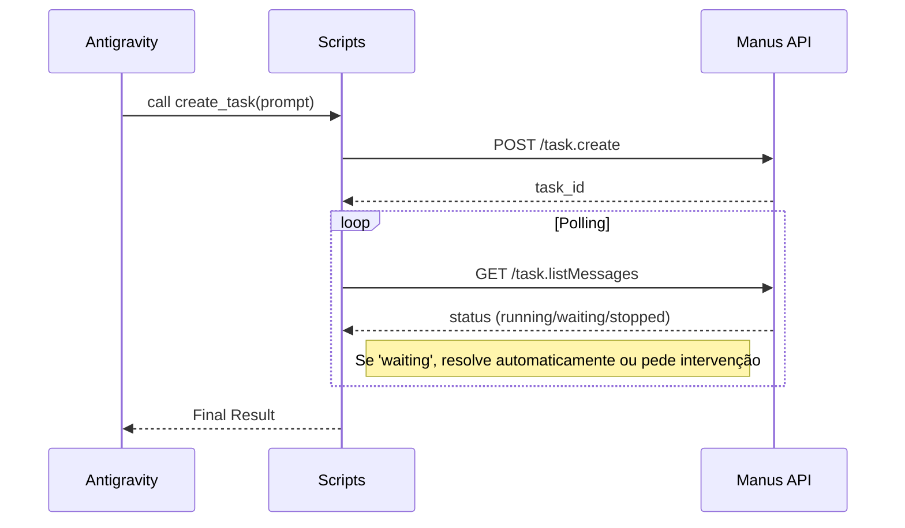

# Manus API Integration

**Purpose**: Fornecer uma interface confiável e automatizada para delegar tarefas ao Manus AI a partir do ecossistema Antigravity.

## Core Principle

> **Delegar e Monitorar**: O sistema deve ser capaz de disparar uma tarefa no Manus, monitorar seu progresso (polling) e retornar o resultado final de forma transparente para o agente orquestrador.

## Como Funciona

### 1. Inicialização
A Skill utiliza a chave API localizada em `Docs/ApiKey Manus.md`.
- **Base URL**: `https://api.manus.ai/v2`

### 2. Fluxo de Execução

## Tratamento de Estados (Task Lifecycle)

| Estado | Ação Recomendada |
| :--- | :--- |
| `running` | Aguardar 5-10 segundos e repetir polling. |
| `waiting` | Analisar `waiting_for_event_type`. Se for pergunta, retornar ao Antigravity. Se for permissão simples, auto-confirmar se seguro. |
| `stopped` | Sucesso. Extrair conteúdo da última `assistant_message`. |
| `error` | Registrar log de erro e notificar o orquestrador. |

## Scripts Disponíveis

- `python .agent/skills/manus-api/scripts/manus_client.py --task "prompt"`: Script principal para execução de ponta a ponta.

## Segurança

> [!WARNING]
> Nunca versione a chave API diretamente. O script `manus_client.py` deve ler a chave de `Docs/ApiKey Manus.md` ou de uma variável de ambiente `MANUS_API_KEY`.
